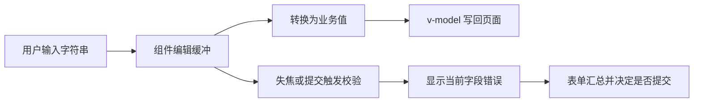

# 输入框组件设计与视频讲解方案

本期以 FullstackSeed 的真实输入组件为案例，讲清三个设计问题：输入控件如何分工，编辑中的文本与最终业务值如何区分，通用校验与业务 rules 如何衔接。目标观众是已经会使用 Vue 表单、准备做二次封装的开发者。

视频采用约 6 分钟的横屏代码讲解，配合实际输入操作；本文件包含设计说明、口播、分镜及录制准备。当前源码行为与建议优化分别标注，录制时只将已经实现并验证的能力作为现有效果展示。

## 1 选题与讲解结论

建议标题：**一个输入框为什么要拆成五种组件？从金额、邮箱讲到 rules 注入**。

封面短句：**输入、取值、校验，分开设计**。

观众看完应能解释：

1. 普通文本、数字、金额换算、邮箱拥有不同的交互和数据契约，适合组成输入组件家族。
2. 用户正在输入的字符串不一定已经是合法的业务值，校验不能替用户决定输入内容。
3. 组件负责通用格式与交互；页面通过 rules 表达业务限制；表单负责提交时统一检查。
4. 传入规则、显示错误、阻止提交是三个需要分别接通的环节。

## 2 当前组件家族

| 组件 | 当前职责 | 对外值 | 讲解重点 |
| --- | --- | --- | --- |
| `Input` | 普通文本、多行、密码、搜索；最终确认时 trim | 接收 `string / number / null`，编辑后通常输出字符串 | 保持薄封装；不承包邮箱、金额等所有模式；当前没有自定义 rules 属性 |
| `InputNumber` | 普通数值、整数、简单金额；保留编辑缓冲；范围校验 | `number / null` | 显示 `1.` 时业务值可以是 `1`；`min/max` 报错而不夹值 |
| `InputAmount` | 金额与百分比视图切换，按总额换算 | `number / null`，含义始终是金额 | 总额 1000 时输入 25%，对外为 250；百分比不是第二份业务值 |
| `InputEmail` | 账号与域名组合输入，支持粘贴完整地址及自定义域名 | `string / null`，内容为完整地址或编辑中的不完整地址 | 一个业务字段可以对应多个控件；例如账号输入完成、域名尚空时可输出 `alice@` |
| `InputPhone` | 手机号输入及格式校验 | `string / null` | 适合作为通用 rules 复用的简短补充案例 |

这些组件在当前源码中是并列实现，并非全部继承或包裹 `Input.vue`。它们共享 Element Plus 控件及 `inputRules.ts` 中的规则函数。讲解图不要画成 `Input → InputNumber → InputAmount` 的实际继承关系。

简单价格输入使用 `InputNumber mode="money"`；需要金额与百分比换算时才选 `InputAmount`。不要为了名称统一，把两种交互强行合成同一个大组件。

### 2.1 三层职责

| 层级 | 应负责 | 示例 |
| --- | --- | --- |
| 输入组件 | 编辑缓冲、控件组合、对外值、通用格式反馈 | 数字清空为 null；邮箱账号与域名组合 |
| 业务页面 | 字段用途、必填、业务范围、跨字段约束 | 企业邮箱限定域名；预算不得超过项目余额 |
| 表单 | 字段布局、校验结果汇总、提交入口 | 提交前等待 validate，通过后再调用业务接口 |

### 2.2 值的流转



这是讲解用的职责模型。当前组件间的行为尚未完全统一，具体差异见第 4 节。

## 3 rules 注入设计

本期的“注入”指通过 `:rules` 属性传入校验函数，不是 Vue `provide/inject`。先讲清现有属性契约，无需为这个案例引入依赖注入容器。

### 3.1 两套 rules 的职责

| 规则入口 | 当前格式 | 作用 |
| --- | --- | --- |
| `InputNumber / InputAmount / InputEmail / InputPhone` 的 `rules` | `(value) => true / 错误字符串` 组成的数组 | 组件同步检查，首个失败即返回，通过组件自身错误区显示 |
| `Form` 的 `rules` | Element Plus `FormRules`，按字段名组织 | 字段触发与整表提交校验，支持其标准 validator 契约 |

两者不能直接混用。当前 `inputRules.ts` 没有 Promise 校验支持，也没有统一的 rules 合并器。远程校验、跨字段等需求要由页面按表单契约组织，不能在视频里直接把异步函数塞入现有 `InputValidator` 数组。

### 3.2 当前优先级必须讲准确

组件的 `getRules()` 按以下顺序取规则：

1. `rulesEnabled=false`：本地规则数组为空，内置与传入的自定义 rules 都不执行。
2. 显式传入 `rules`：整组覆盖默认规则，`[]` 也算覆盖。
3. 未传入 `rules`：使用组件默认规则；`required=true` 才增加必填规则。

所以传入公司邮箱规则时，要显式组合必填、格式和业务条件，不能假定默认邮箱规则还会自动追加。`InputAmount` 的百分比基准检查另有独立分支，即使关闭 rules，也仍可能提示“请先提供总金额”。

### 3.3 演示代码一 组合规则并传给邮箱组件

以下是基于当前公开属性的教学示例，不是仓库页面现有代码。

```vue
<script setup lang="ts">
import { ref } from 'vue';
import InputEmail from '@/components/InputEmail.vue';
import {
  requiredRule,
  emailRule,
  type InputValidator,
} from '@/components/inputRules';

const email = ref<string | null>('');
const emailRef = ref<InstanceType<typeof InputEmail>>();

const emailRules: InputValidator<string | null>[] = [
  requiredRule('请填写邮箱'),
  emailRule(),
  (value) =>
    value?.toLowerCase().endsWith('@example.com') || '请使用公司邮箱',
];

function checkBeforeSubmit() {
  return emailRef.value?.validate() === true;
}
</script>

<template>
  <InputEmail ref="emailRef" v-model="email" :rules="emailRules" />
</template>
```

画面依次输入空值、`alice@`、`alice@other.com`、`alice@example.com`，分别显式触发 `checkBeforeSubmit()` 或相应失焦。重点标出“组件格式”和“页面业务规则”的分工。单独使用输入组件时，由调用方读取 validate 结果决定是否继续；仅出现红色提示不代表提交必然被拦截。

### 3.4 演示代码二 接入表单提交校验

若该示例改放入当前动态 Form，可把同一组函数适配为字段 validator，并关闭邮箱组件本地规则，选择一个错误展示入口。下面片段中的 `emailRules` 使用上一个示例的完整规则数组。

```ts
import type { FormRules } from 'element-plus';
import type { FormField } from '@/components/Form.vue';
import { runInputRules } from '@/components/inputRules';

const fields: FormField[] = [
  {
    prop: 'email',
    label: '邮箱',
    component: 'InputEmail',
    componentProps: { rulesEnabled: false },
  },
];

const formRules: FormRules = {
  email: [
    {
      validator: (_rule, value, callback) => {
        const result = runInputRules(value, emailRules);
        if (result === true) callback();
        else callback(new Error(result));
      },
      trigger: 'blur',
    },
  ],
};
```

调用时将 `fields`、`formRules` 和 `{ email: '' }` 模型传给 Form，在业务提交函数中先 `await formRef.validate()`，校验拒绝后不继续保存。图中使用两条清晰路径：`componentProps.rules → 输入组件`，`Form.rules → el-form`；本例使用后者，不重复在两处展示同一错误。

## 4 当前实现与后续优化的边界

| 项目 | 当前源码事实 | 视频处理与建议方向 |
| --- | --- | --- |
| 数字范围 | `InputNumber` 的 min/max 只校验；`InputAmount` 对完整数值在输入和最终确认时都可能 round + clamp | 用 InputNumber 演示“1 → 18 → 180”；金额换算示例使用范围内数值。统一金额行为可作为下一期整改任务 |
| 提交汇总 | Form 额外收集的组件 ref 仅限动态 `InputNumber`；邮箱、手机号、金额及自定义插槽没有被统一扫描 | 本期邮箱示例显式调用 ref.validate，或使用第 3.4 节的 FormRules 适配；不宣称所有组件错误都会阻止提交 |
| 示例模块 | demo 中的邮箱、手机号、预算组件已配置，但页面 FormRules 目前只写了标题、分类 | 可用于展示控件外观；完整校验演示使用明确接通提交校验的教学案例 |
| 自定义规则 | 当前传入 rules 会整体覆盖默认规则 | 本期显式组合规则；后续若增加追加模式，先定义兼容方式，不悄悄改变旧 rules 语义 |
| 金额精度 | 当前组件使用 JavaScript number，限制小数位不等于提供精确十进制记账 | 本期讲输入交互和金额含义，不宣传为财务精度方案；分单位整数或十进制方案须另行对齐后端字段 |
| 邮箱格式 | 当前是简化格式规则，不能确认地址可收信；手机号规则针对大陆常见格式 | 表述为“格式校验”，不说“验证了真实邮箱或所有国家手机号” |

若后续需要统一实现，优先定义可校验输入组件的公共契约，再让 Form 收集明确声明支持该契约的动态字段，并明确插槽注册方式、错误展示归属和重置行为。异步校验需要单独处理旧响应与提交等待，不在此次视频筹备中暗中扩展。

## 5 分镜与口播

总时长目标约 6 分钟；口播与操作交替，代码画面每次只突出一个函数或一个条件。

| 时间 | 画面及操作 | 口播要点 |
| --- | --- | --- |
| 00:00–00:25 | 展示普通文本、金额、邮箱三个输入；用标注为“问题示意”的动画表现输入 1 被改为 10 | 同样叫输入框，真正难的是输入过程、最终值和校验之间的配合 |
| 00:25–01:05 | 组件职责卡片；突出 InputNumber 的 money 与 InputAmount 的差别 | 按交互与数据含义分工；普通价格与百分比换算是两种需求 |
| 01:05–02:00 | InputNumber 设置 min=10、max=200，输入 1、18、180；再输入 1 并失焦；画面显示 inputBuffer 与 model | 输入中允许过渡状态；范围错误要提示，保留用户输入；文本 1. 与数值 1 可以同时存在 |
| 02:00–02:45 | 总额 1000，金额 250，切换 25%；旁边展示最终数据仍为 250；再展示邮箱拆分 | 控件布局可以复杂，对外业务值应稳定；视图不是第二份业务数据 |
| 02:45–04:00 | 聚焦 InputValidator、runInputRules、getRules；切换默认规则与公司邮箱规则 | 返回 true 或错误字符串，按顺序执行；显式 rules 覆盖默认规则，因此需要主动组合 |
| 04:00–05:15 | 展示组件 rules 和 Form.rules 两条路径；用独立 ref 校验与 FormRules 适配示例演示提交拦截 | 单字段错误提示与提交拦截要分别接通；当前两套接口不能直接混用 |
| 05:15–06:00 | 展示当前差异清单，再展示职责分工的最终图 | 已有设计的价值在于职责清楚；金额夹值、统一提交校验是后续可继续完善的具体点 |

### 逐段口播稿

**开场**

“封装输入框，很容易先做成一个带很多参数的大组件：文本、数字、金额、邮箱都往里面塞。但实际用起来，问题经常出在最细的地方。比如我要输入一百八十，刚敲下一个一，组件就按照最小值把它改成十。今天用这个项目里的真实组件，讲清输入过程、业务值和校验应该怎么分工。”

**组件分工**

“普通 Input 保留文本输入、密码和搜索这些基础交互。数字输入单独处理整数、小数以及空值。如果只是填价格，用数字组件的金额模式就够了；如果需要在金额和百分比之间切换，再使用 InputAmount。邮箱则是一个完整字段，但界面可以拆成账号和域名。这里共享的是控件基础与校验函数，不是要求所有组件都继承一个越来越大的 Input。”

**编辑状态**

“看这个输入过程：一、十八、一百八十。中间的一虽然小于最小值，但它可能只是用户还没输入完。组件先保留编辑中的文本，再把能解析的数值交给页面。比如画面上是一点，业务值暂时可以是一。等到失焦或者提交，再告诉用户范围是否正确，而不是提前替他改掉数值。”

**金额与邮箱**

“总金额是一千，当前金额是二百五十，切到百分比就是百分之二十五。这里的 v-model 始终是二百五十，页面不用猜这个数字到底是金额还是比例。邮箱也一样，账号和域名虽然是两个控件，对外仍然是一个地址。组件负责组织输入，业务页面关心最后得到的值。”

**规则传入**

“哪些内容应该放进组件？数字范围、邮箱格式这些可以复用。但必须使用公司邮箱，就属于页面自己的业务规则。我们把规则写成函数，成功返回 true，失败返回一句具体错误，再通过 rules 属性传给组件。这里有个容易忽略的细节：当前传入 rules 会覆盖默认规则，所以必填、格式和公司域名要明确组合，不能以为默认校验还会自动补上。”

**提交校验**

“接下来要看提交。输入框显示红字，并不代表保存按钮一定会被拦住。当前组件规则与 Form 的字段规则是两套接口。单独使用时，可以显式调用组件的 validate；放入表单时，可以把同一组规则适配到 FormRules，再由提交函数等待整表校验。这个项目目前额外接入的是动态数字组件，其它输入的提交校验还需要明确安排。”

**结尾**

“这套封装还有值得继续统一的地方，比如金额组件仍保留了范围夹值，表单也还没有收集所有输入组件的校验。后续优化会沿着同一个原则：组件管输入体验，页面管业务条件，表单管提交检查。先把值和校验的责任说清楚，复用才能减少重复，而不是把问题藏进公共组件。”

## 6 演示清单与画面要求

| 演示 | 输入或配置 | 预期要观察的结果 |
| --- | --- | --- |
| 普通文本 | 文本前后带空格 | 输入过程中保留；change/blur 时按 trim 处理 |
| 数字连续输入 | min=10，max=200；1 → 18 → 180 | 输入不被边界强制改写；输入 1 后失焦提示范围错误 |
| 小数编辑状态 | 普通数字模式输入 1.、1.20 | 聚焦编辑时保留文本形态；业务值为数值；失焦后允许显示归一化 |
| 数字清空 | 清空数量 | 模型为 null；required 开启时校验失败 |
| 简单价格 | money，precision=2，输入 12.345 | 当前实现保留前两位小数，不能讲成自动四舍五入 |
| 金额换算 | totalAmount=1000，金额 250 | 切换到 25%，模型仍为 250 |
| 公司邮箱 | 空、alice@、alice@other.com、alice@example.com | 依次触发必填、格式、公司域名错误，最后通过 |
| 覆盖语义 | 显式 rules=[]；另一个示例 rulesEnabled=false | 本地规则不执行；不能讲成关闭全部表单校验 |
| 提交拦截 | 采用 ref.validate 或 FormRules 适配 | 失败时不进入保存逻辑；成功时展示教学结果，避免写入真实业务记录 |

画面采用 1920×1080 横屏，交互演示与代码区域交替放大；代码字号至少约 28px，每屏尽量不超过 16 行。复杂片段拆镜头展示，不把完整 Form 文件缩小塞进一屏。讲解字幕和数据观察标签放在视频画面中，现有业务页面不新增解释性文案。

历史问题通过“问题示意”动画或历史代码对比表达，不伪装成当前版本仍会出现的实录。录制前逐项确认上述交互；本次筹备不等同于已经完成录制或浏览器验收。

交付素材建议保留：口播稿、分镜表、教学代码片段、组件操作录像、字幕文件，以及最终 MP4。首期以源码拆解为主，统一组件校验机制可独立作为下一期改造案例。

## 7 源码定位

- [Input.vue](../web/src/components/Input.vue)：`parseValue`、`handleInput`、`handleChange`、`handleBlur`。
- [InputNumber.vue](../web/src/components/InputNumber.vue)：`inputBuffer`、`parseValue`、`normalizeNumber`、`getRules`、`validate`。
- [InputAmount.vue](../web/src/components/InputAmount.vue)：`toAmountValue`、`toPercentAmountValue`、`clampAmount`、`getRules`。
- [InputEmail.vue](../web/src/components/InputEmail.vue)：`syncPartsFromModel`、`composeValue`、`getRules`、`validate`。
- [InputPhone.vue](../web/src/components/InputPhone.vue)：格式规则及 `validate`。
- [inputRules.ts](../web/src/components/inputRules.ts)：同步规则类型、首错返回及通用校验函数。
- [Form.vue](../web/src/components/Form.vue)：动态组件渲染、`numberInputs`、`validate`。
- [demo/Edit.vue](../web/src/views/demo/Edit.vue)：已有输入组件组合示例。
- [AGENTS-COMPONENTS.md](../AGENTS-COMPONENTS.md)：公共组件契约。
